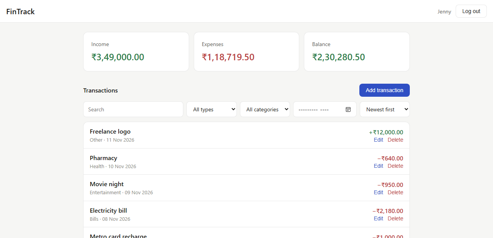
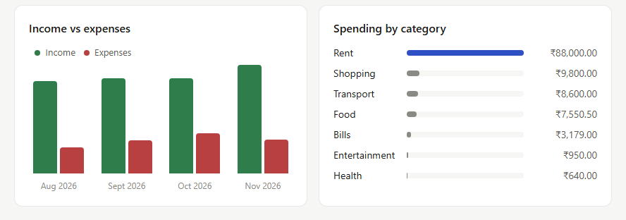
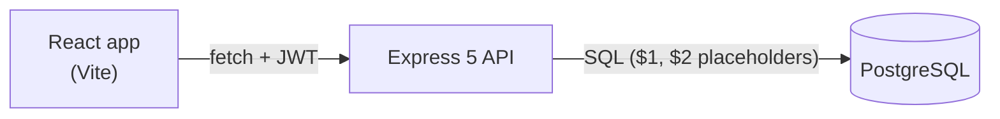
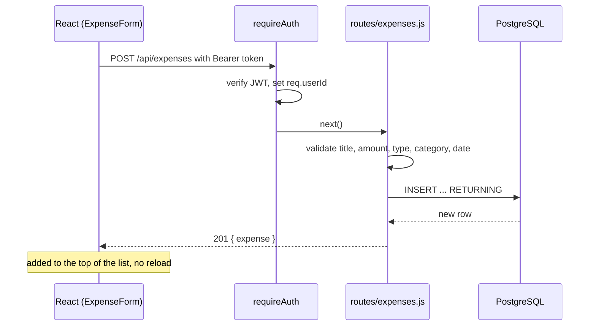
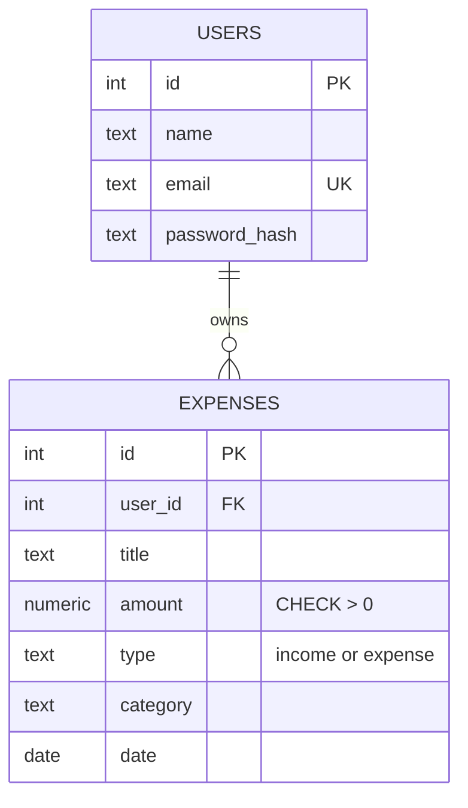

<div align="center">

# FinTrack

**Know where your money goes.**
A full-stack expense tracker built with React, Express and PostgreSQL.

[Features](#features) · [How it works](#how-it-works) · [API](#api) · [Run it locally](#run-it-locally)

<br />



</div>

<br />

## Features

| | |
|---|---|
| **Accounts** | Register and log in. Passwords are hashed with bcrypt, and sessions use a JWT |
| **Transactions** | Add, edit and delete income and expenses, with a category and a date |
| **Find anything** | Search by title, filter by type, category or month, and sort by date or amount |
| **Totals** | Income, expenses and balance update as you filter |
| **Charts** | Income vs expenses for the last 6 months, and spending by category, drawn with plain CSS (no chart library) |
| **Private by design** | Every query is scoped to the logged-in user, so nobody can see or change anyone else's data |



## How it works



The browser never talks to the database. Every request goes through the API, which checks the token first.

### Adding an expense



### Data model



Deleting a user deletes their expenses (`ON DELETE CASCADE`), and an index on `(user_id, date)` keeps the main query fast.

## API

All `/api/expenses` routes need `Authorization: Bearer <token>`.

| Method | Route | What it does |
|---|---|---|
| `POST` | `/api/auth/register` | Create an account, returns `{ token, user }` |
| `POST` | `/api/auth/login` | Log in, returns `{ token, user }` |
| `GET` | `/api/auth/me` | The current user (used to restore a session) |
| `GET` | `/api/expenses` | All of your expenses, newest first |
| `POST` | `/api/expenses` | Add one |
| `PUT` | `/api/expenses/:id` | Update one of yours |
| `DELETE` | `/api/expenses/:id` | Delete one of yours |
| `GET` | `/api/health` | `{ "status": "ok" }` |

## Tech

| Frontend | Backend | Database |
|---|---|---|
| React 18, React Router | Node, Express 5 | PostgreSQL |
| Vite | jsonwebtoken, bcryptjs | `pg` connection pool |

## Run it locally

You need **Node 20+** and **PostgreSQL**.

```bash
createdb expense_tracker
```

```bash
cd backend
npm install
cp .env.example .env      # set DATABASE_URL and JWT_SECRET
npm run db:init           # creates the tables from schema.sql
npm run dev               # http://localhost:4000
```

```bash
cd frontend
npm install
cp .env.example .env
npm run dev               # http://localhost:5173
```

If `npm run db:init` can't find `$DATABASE_URL`, run `psql "<your connection string>" -f schema.sql` instead.

<details>
<summary><b>Where things live</b></summary>
<br />

| File | What it does |
|---|---|
| `backend/schema.sql` | The `users` and `expenses` tables |
| `backend/src/server.js` | Express app, CORS, JSON parsing, routes, and the central error handler |
| `backend/src/db.js` | Shared PostgreSQL connection pool |
| `backend/src/middleware/auth.js` | Verifies the JWT and sets `req.userId` |
| `backend/src/routes/auth.js` | Register, login, me |
| `backend/src/routes/expenses.js` | CRUD for expenses, validation, user scoping |
| `frontend/src/api/client.js` | One `request()` helper for every API call |
| `frontend/src/context/AuthContext.jsx` | The user, login, register, logout, and session restore |
| `frontend/src/pages/DashboardPage.jsx` | Loads expenses, then filters, sorts and totals them |
| `frontend/src/components/` | Form, list, filters, summary cards and the two charts |

</details>

<br />

<div align="center">
<sub>Built by <a href="https://github.com/jennyasync">jennyasync</a></sub>
</div>
